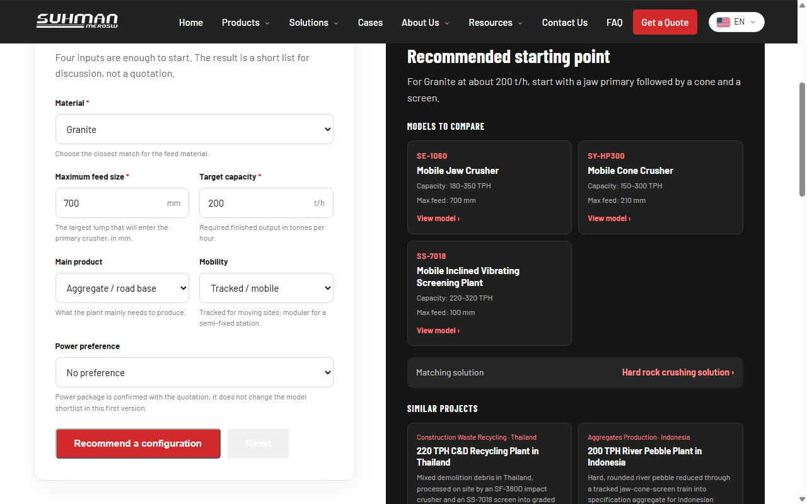
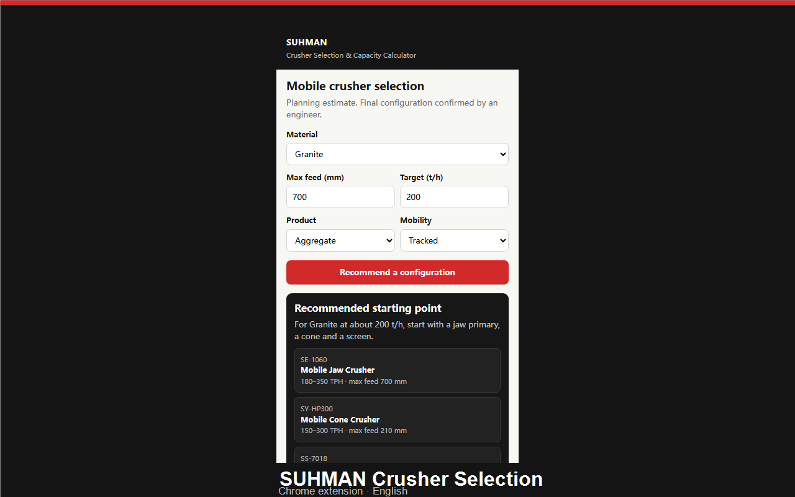

# SUHMAN Crusher Selection & Capacity Calculator

Open calculation core for the SUHMAN mobile crusher selection and capacity calculator.

**Official web version:** [suhmancrusher.com/tools/crusher-selection](https://suhmancrusher.com/tools/crusher-selection)

This repository contains the shared engineering logic behind the SUHMAN web tool and the Chrome extension source. It is not a quotation engine and does not collect customer data.



## What this tool does

The calculator narrows a mobile crushing and screening configuration from:

- material
- maximum feed size
- target finished output
- main product
- tracked or modular preference

It returns a starting crusher line, up to four models to compare, a matching solution and similar project references.

## Supported inputs

```text
material:
  granite, basalt, river pebble, iron ore, limestone,
  C&D waste, other hard rock, other soft rock

max feed:       50–1,500 mm
target output:  20–1,000 t/h
main product:   aggregate, several sizes, manufactured sand, not sure
mobility:       tracked, modular, no preference
```

## How the recommendation works

Hard, abrasive rock starts with a jaw and normally a cone. Soft limestone and C&D waste can start with an impact crusher. Screening is added for sized products.

For screening models, the published **lower capacity is treated as zero for selection**. Eligibility uses only the upper capacity:

```text
SS-7018    0–320 t/h   tracked
SSP-6200   0–400 t/h   tracked
SZ-450D    0–500 t/h   tracked
SS-J7018   0–320 t/h   modular
```

Priority:

```text
Tracked:  SS-7018 → SSP-6200 → SZ-450D
Modular:  SS-J7018 first
```

Above 500 t/h, the tool does not force a standard screen. It asks for an engineer-confirmed custom configuration.

## Example: 200 t/h granite

Input:

```text
Material: granite
Maximum feed: 700 mm
Target output: 200 t/h
Mobility: tracked
```

Recommended starting point:

```text
SE-1060 Mobile Jaw Crusher
SY-HP300 Mobile Cone Crusher
SS-7018 Inclined Vibrating Screening Plant
```

Reference pages:

- [SE-1060 Mobile Jaw Crusher](https://suhmancrusher.com/jaw-crusher/se-1060-mobile-jaw-crusher)
- [SY-HP300 Mobile Cone Crusher](https://suhmancrusher.com/cone-crusher/sy-hp300-mobile-cone-crusher)
- [SS-7018 Mobile Screening Plant](https://suhmancrusher.com/screening-plant/ss-7018-mobile-inclined-vibrating-screening-plant)

## Run the Web version

Use the full official tool when you need the current model database, localized pages and inquiry form:

[https://suhmancrusher.com/tools/crusher-selection](https://suhmancrusher.com/tools/crusher-selection)

Repository demo:

```bash
python -m http.server 8080
# open http://localhost:8080/apps/demo/
```

## Development

```bash
npm test
node scripts/build-extension.mjs
```

`build-extension.mjs` copies the core selection module and local dataset into the Chrome extension folder.

## Chrome extension

The Manifest V3 extension source is in `apps/chrome-extension/`.



- English UI
- No host permissions
- No remote code
- No customer-data collection
- Local model data only
- Links to the official full calculator

The Chrome Web Store listing will be added after review.

## Data and limitations

Model data is exported from the SUHMAN CMS product registry. The repository does not include customer contact data, prices or private back-office data.

Results are planning estimates. Actual throughput depends on gradation, moisture, feed distribution, closed-side setting, screening efficiency and the final product. Confirm the configuration with an engineer before ordering.

## FAQ

**Is the t/h result guaranteed?**  
No. It is a planning range. An engineer confirms the final configuration.

**Why does the calculator recommend more than one machine?**  
Most hard-rock plants need a primary, secondary and screen. Soft-rock and demolition projects can sometimes use one impact crusher plus a screen.

**Does the Chrome extension send data to SUHMAN?**  
No. The extension calculates locally and does not collect personal data.

## About SUHMAN

SUHMAN Engineering Machinery Co., Ltd. manufactures track-mounted mobile crushing and screening equipment for quarries, mines and construction-waste recycling projects.

- [Official website](https://suhmancrusher.com/)
- [Products](https://suhmancrusher.com/products)
- [Cases](https://suhmancrusher.com/cases)
- [Contact](https://suhmancrusher.com/contact)

## License

MIT
